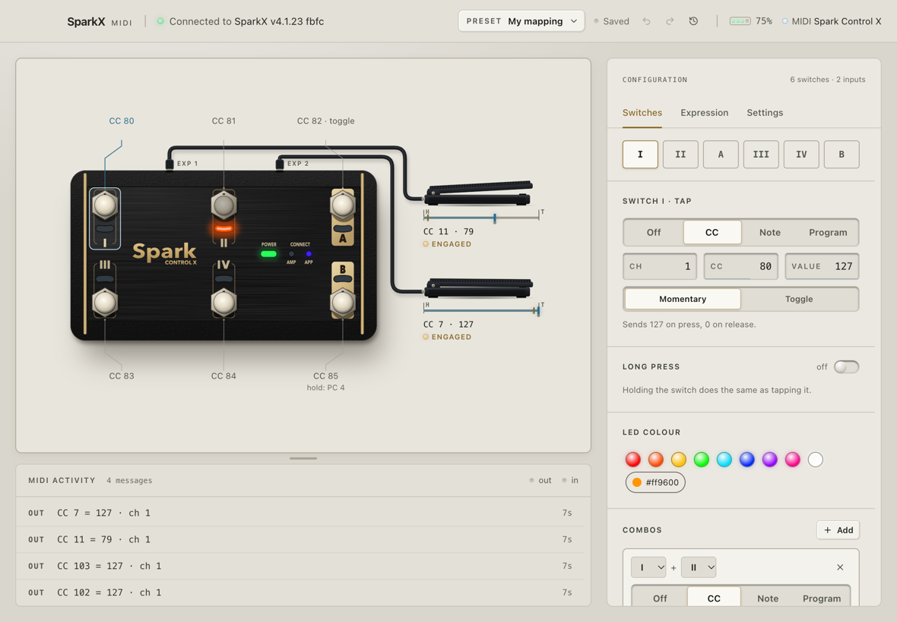
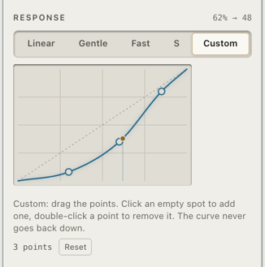

# Flintstep

[](https://github.com/pierre-borckmans/flintstep/actions/workflows/ci.yml)
[](https://github.com/pierre-borckmans/flintstep/releases/latest)
[](LICENSE)

Use a Positive Grid Spark Control X as a MIDI foot controller on your Mac.

Flintstep is a menu-bar app. It connects to the pedal over Bluetooth and shows up as a MIDI device called **Flintstep** in Logic, Ableton, MainStage or anything else that takes MIDI. You don't need the Spark app, an amp or a firmware update.

<picture>
  <source media="(prefers-color-scheme: dark)" srcset="site/img/app-dark.png">
  
</picture>

<https://flintstep.app>

## What it does

- Six switches. Each sends a CC (momentary or toggle), a note or a program change. A long press can send something else, and pressing two together is a trigger of its own. Defaults are CC 80 to 85 on channel 1.
- Two expression inputs for TRS pedals, CC 11 and CC 7 by default. Click Calibrate, rock the pedal a few times and Flintstep learns heel and toe. A response curve puts the resolution where you want it: gentle start, fast start, an S you can shape, or your own curve through points you drag.
- LEDs your DAW can drive. Send the same CC back to the **Flintstep LEDs** port and the switch lights to match, say a plugin bypassed or a track armed. Without feedback, a switch lights while held or while its toggle is on.
- Presets, one per DAW or per gig, switchable from the menu bar, each with its own undo history. Export one to use it on another Mac.

<picture>
  <source media="(prefers-color-scheme: dark)" srcset="site/img/curve-dark.png">
  
</picture>

Flintstep never writes to the profiles stored on the pedal. LED colours it sets are gone after a power cycle.

## Install

Download the DMG from [Releases](https://github.com/pierre-borckmans/flintstep/releases), open it and drag Flintstep to Applications. Universal build, macOS 12 or later.

Builds aren't notarised yet, so macOS blocks the first launch. Open the app once, then click Open Anyway in System Settings > Privacy & Security. Or run:

```sh
xattr -dr com.apple.quarantine /Applications/Flintstep.app
```

Turn the pedal on, keep the Spark app closed, and allow Bluetooth when asked. The pedal takes one connection at a time.

**Expression pedals** need a TRS cable and a TRS pedal. The M-Audio EX-P works with its polarity switch on M-Audio. If the range looks short or bent, flip the polarity switch. Two-wire pedals such as the Line 6 EX-1 read zero.

**Coming from SparkX MIDI** (the old name): your presets move over on first launch. Pick the new **Flintstep** ports in your DAW and allow Bluetooth again.

## Other pedals and platforms

- **REACTOR Control.** Same hardware with one expression jack, so it should work. Nobody has tried one: please [report how it goes](https://github.com/pierre-borckmans/flintstep/issues/new?template=pedal_compatibility.yml). Turn the REACTOR amp off first.
- **Other AirTurn-based pedals** show up as "(unverified)" in Scan. Flintstep only connects if you pick one.
- **Linux** has an experimental build that hasn't met a real pedal yet. See [docs/LINUX.md](docs/LINUX.md).

## Develop

Go 1.25+, bun 1.3.14, Wails v2.17 and golangci-lint v2.

```sh
make install   # frontend deps
make cert      # once per Mac, so the Bluetooth permission survives rebuilds
make dev       # wails dev with live reload
make check     # lint and tests, as CI runs them
make app       # build/bin/Flintstep.app
```

`go run ./cmd/flintstep-cli` bridges the pedal without the UI and prints every message.

More in `docs/`: [PROTOCOL-NOTES](docs/PROTOCOL-NOTES.md) (how the pedal talks), [CONTRACTS](docs/CONTRACTS.md) (how the packages fit), [RELEASING](docs/RELEASING.md) (signing and releases), [PORTING](docs/PORTING.md). Data lives in `~/Library/Application Support/Flintstep/`.

## Credits

Paul Hamshere's [Spark-Control-X](https://github.com/paulhamsh/Spark-Control-X) notes first wrote the protocol down. Parts of the Bluetooth layer come from my earlier BEAM Mini controller project.

## Licence

MIT, see [LICENSE](LICENSE). Bundled dependencies are listed in [THIRD_PARTY_NOTICES.md](THIRD_PARTY_NOTICES.md). See also [CONTRIBUTING.md](CONTRIBUTING.md) and [SECURITY.md](SECURITY.md).

Spark, Spark Control X, REACTOR and REACTOR Control are trademarks of Positive Grid. Flintstep is not affiliated with or endorsed by Positive Grid.
